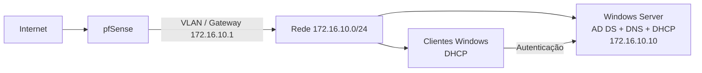

# Windows Server — Active Directory, DNS e DHCP

> Projeto de laboratório para implementação de serviços de domínio Microsoft Windows Server, realizado em novembro de 2026.

## 1. Objetivo

Neste projeto configurei um **Windows Server como Domain Controller** para centralizar autenticação, DNS e distribuição de endereços IP no homelab.

Os principais objetivos foram:

1. Instalar a função **Active Directory Domain Services (AD DS)**.
2. Criar uma nova floresta com o domínio **`homelab.local`**.
3. Promover o Windows Server a **Domain Controller**.
4. Confirmar o domínio através de **Active Directory Users and Computers**.
5. Instalar e configurar o **DHCP Server**.
6. Criar e ativar um scope para a rede **`172.16.10.0/24`**.
7. Preparar a integração com o **pfSense**, que será o gateway da VLAN.

## 2. Endereçamento utilizado

| Componente | Configuração |
|---|---|
| Rede | `172.16.10.0/24` |
| pfSense / Gateway | `172.16.10.1` |
| Windows Server / Domain Controller | `172.16.10.10` |
| DNS dos clientes | `172.16.10.10` |
| Pool DHCP | a partir de `172.16.10.100` |
| Domínio | `homelab.local` |
| NetBIOS | `HOMELAB` |

### Topologia lógica



## 3. Instalação do Active Directory

Instalei a função **Active Directory Domain Services** através do **Server Manager → Add Roles and Features**.

No início, o servidor chegou a apresentar um endereço `169.254.x.x`, ou seja, um endereço APIPA. Para um Domain Controller é importante utilizar um IP previsível, por isso foi definido o seguinte planeamento:

```text
IP:      172.16.10.10
Mask:    255.255.255.0
Gateway: 172.16.10.1
DNS:     172.16.10.10
```

O gateway corresponde à interface do pfSense na VLAN.


*Figura 1 — AD DS instalado no Server Manager.*


*Figura 2 — Notificação de pós-instalação com a opção para promover o servidor a Domain Controller.*


*Figura 3 — Seleção de **Add a new forest** no assistente de configuração do Active Directory.*


*Figura 4 — Definição de `homelab.local` como Root domain name.*

## 4. Criação da floresta e promoção a Domain Controller

Depois de instalar o AD DS, o Server Manager apresentou a opção:

**Promote this server to a domain controller**

Como o objetivo era criar um ambiente novo, selecionei:

**Add a new forest**

e defini:

```text
Root domain name: homelab.local
```

O nome NetBIOS atribuído automaticamente foi:

```text
HOMELAB
```


*Figura 5 — Nome NetBIOS `HOMELAB` atribuído ao domínio.*

Assim, um utilizador pode autenticar-se no formato:

```text
HOMELAB\utilizador
```

ou através de um UPN:

```text
utilizador@homelab.local
```

Durante o assistente surgiu um aviso de **DNS delegation**. Neste laboratório não foi necessário criar essa delegação porque `homelab.local` é uma zona DNS interna criada pelo próprio Domain Controller.

## 5. Verificação dos pré-requisitos

Antes da instalação final, o assistente apresentou:

> All prerequisite checks passed successfully.

Foram mostrados avisos relacionados com o IP estático e com a delegação DNS. O aviso DNS era esperado neste cenário.

Depois da promoção, o servidor reiniciou e passou a funcionar como Domain Controller.


*Figura 6 — O assistente confirma que os pré-requisitos foram validados com sucesso.*

## 6. Validação no Active Directory Users and Computers

Abri:

**Server Manager → Tools → Active Directory Users and Computers**

e confirmei o domínio:

```text
homelab.local
```

Foram criados os containers padrão, incluindo:

- Builtin
- Computers
- Domain Controllers
- ForeignSecurityPrincipals
- Managed Service Accounts
- Users

Também ficaram disponíveis grupos como **Domain Admins**, **Domain Users**, **Domain Computers**, **Enterprise Admins** e **DnsAdmins**.


*Figura 7 — O domínio `homelab.local` visível na consola Active Directory Users and Computers.*


*Figura 8 — Containers e grupos padrão criados pelo Active Directory.*

## 7. Organização do Active Directory

Para não utilizar apenas os containers padrão, comecei a organizar o ambiente com **Organizational Units (OUs)**.

Estrutura planeada:

```text
homelab.local
├── Utilizadores
│   ├── Alunos
│   ├── Professores
│   └── Administracao
├── Grupos
├── Computadores
└── Servidores
```

Para os grupos de segurança posso usar uma convenção como:

```text
GG_Alunos
GG_Professores
GG_Administracao
GG_TI
```

A utilização de OUs permite aplicar **Group Policy Objects (GPOs)** de forma mais organizada.

## 8. Instalação do DHCP Server

Depois de ter o Active Directory e o DNS operacionais, instalei a função **DHCP Server** através do Server Manager.

No final da instalação executei:

**Complete DHCP configuration**

para concluir a configuração do serviço no domínio.


*Figura 9 — Instalação da função DHCP Server concluída no Server Manager.*

## 9. Criação do scope DHCP

Na consola **DHCP**, criei um novo scope IPv4 para a rede do laboratório.

| Campo | Valor |
|---|---|
| Scope | `homelab` |
| Rede | `172.16.10.0/24` |
| Máscara | `255.255.255.0` |
| Início do Address Pool | `172.16.10.100` |
| Gateway | `172.16.10.1` |
| DNS | `172.16.10.10` |
| DNS Domain | `homelab.local` |

No **New Scope Wizard**, escolhi:

**Yes, I want to configure these options now**

para configurar logo gateway, DNS e restantes opções entregues aos clientes.

O scope foi depois **ativado**.


*Figura 10 — Configuração das opções DHCP durante o New Scope Wizard.*


*Figura 11 — Address Pool do scope `172.16.10.0/24`, iniciado em `172.16.10.100`.*


*Figura 12 — Visão geral do Server Manager após a configuração dos serviços do Windows Server.*

## 10. Relação entre Windows Server e pfSense

A infraestrutura foi dividida da seguinte forma:

### Windows Server

- Domain Controller
- Active Directory
- DNS interno
- DHCP

### pfSense

- gateway da VLAN;
- routing entre redes;
- firewall;
- NAT;
- acesso à Internet.

### Clientes

Os clientes recebem por DHCP:

```text
IPv4:    172.16.10.x
Gateway: 172.16.10.1
DNS:     172.16.10.10
Domain:  homelab.local
```

Os clientes do domínio devem utilizar o **DNS do Domain Controller**, porque o Active Directory depende dos registos DNS internos para localizar os seus serviços.

## 11. Testes DHCP

Num cliente Windows, a concessão pode ser renovada com:

```powershell
ipconfig /release
ipconfig /renew
ipconfig /all
```

Depois podem ser feitos testes como:

```powershell
ping 172.16.10.10
ping 172.16.10.1
nslookup homelab.local
```

O scope ficou ativo e os clientes passaram a receber configuração de rede automaticamente.

## 12. Próximo passo

Com **AD DS + DNS + DHCP** operacionais, o próximo passo é adicionar um Windows cliente ao domínio:

```text
Cliente recebe IP por DHCP
        ↓
DNS aponta para 172.16.10.10
        ↓
Cliente resolve homelab.local
        ↓
Computador entra no domínio
        ↓
Reinício
        ↓
Login com HOMELAB\utilizador
        ↓
Aplicação de GPOs
```

Depois será possível testar:

- autenticação centralizada;
- utilizadores e grupos;
- políticas de password;
- Group Policy;
- organização de computadores por OU;
- permissões e recursos de rede.

## 13. Estado atual

### Concluído

- [x] AD DS instalado
- [x] domínio `homelab.local` criado
- [x] Windows Server promovido a Domain Controller
- [x] DNS instalado
- [x] Active Directory validado
- [x] estrutura inicial de OUs preparada
- [x] DHCP Server instalado
- [x] scope IPv4 criado
- [x] scope DHCP ativado
- [x] clientes a receber configuração DHCP

### Próximas etapas

- [ ] integrar definitivamente a VLAN com pfSense
- [ ] adicionar Windows cliente ao domínio
- [ ] criar utilizadores e grupos de teste
- [ ] aplicar GPOs
- [ ] testar autenticação no domínio
- [ ] documentar políticas e permissões

---

[Voltar aos projetos](../) · [Projeto pfSense](../07-pfsense-firewall-dhcp-dns/)
