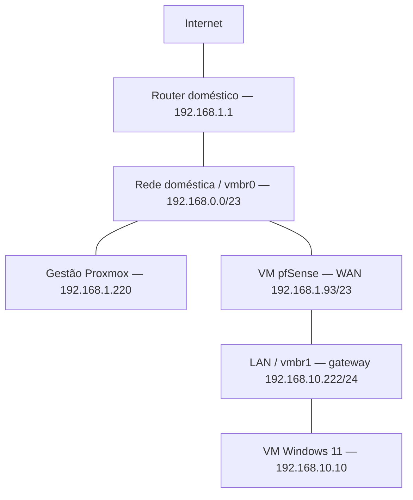
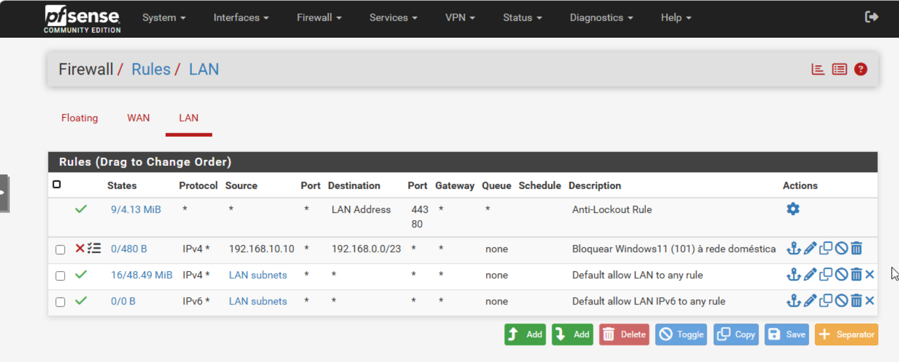
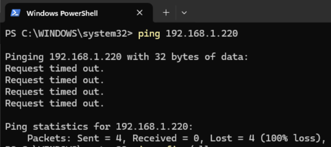
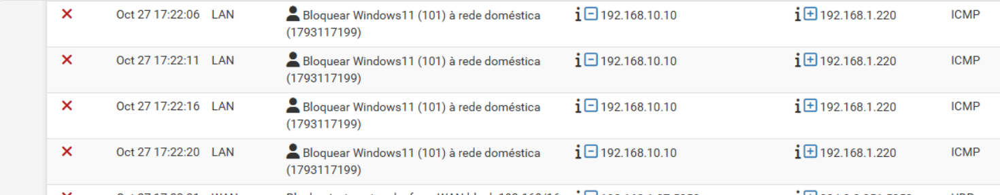
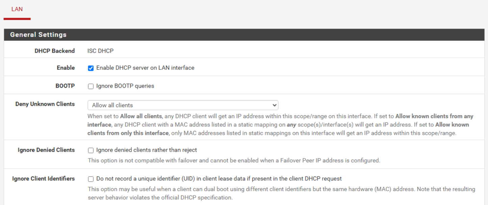
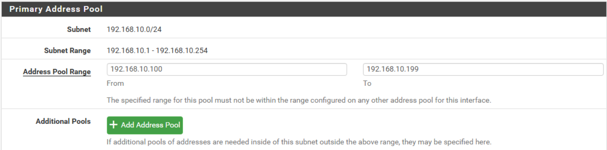
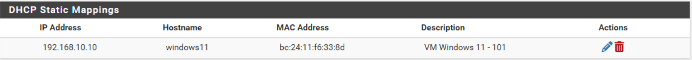
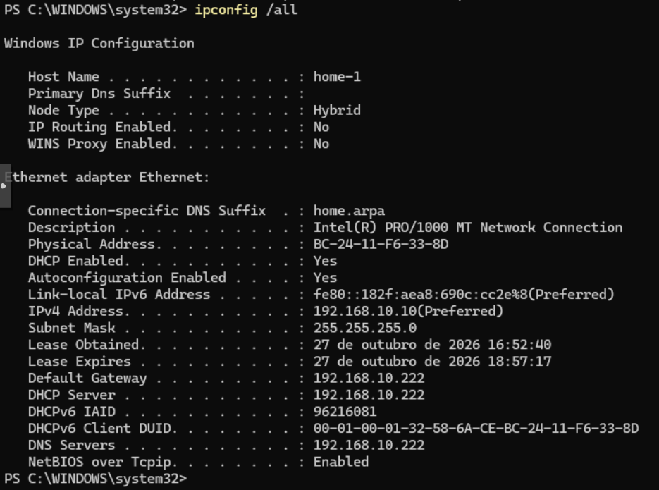
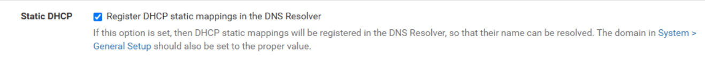
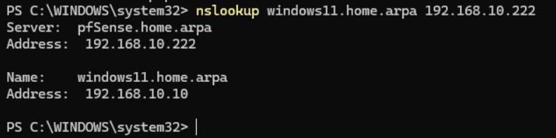

# pfSense no Proxmox — Firewall, DHCP e DNS

> Projeto pessoal de administração de redes, realizado em outubro de 2026.

## 1. Objetivo e resultados

Instalei o **pfSense CE 2.9.0 numa máquina virtual no Proxmox VE** e configurei uma rede LAN para o laboratório, separada da rede doméstica. Depois implementei e testei duas componentes:

1. **Controlo de acesso IPv4:** bloquear a VM Windows 11 de aceder à rede doméstica, mantendo a navegação na Internet.
2. **Administração de DHCP e DNS:** atribuir automaticamente um endereço reservado à VM e resolver o seu nome local.

A primeira componente é uma restrição de rede. A segunda centraliza a configuração de endereços e nomes; não é uma regra de bloqueio.

| Resultado | Evidência |
|---|---|
| Bloqueio de Windows para o Proxmox na rede doméstica | Ping sem resposta e entrada correspondente no log da regra |
| Navegação na Internet mantida | Página externa aberta na VM |
| IP reservado atribuído por DHCP | `ipconfig /all` com DHCP ativo e IP `192.168.10.10` |
| Nome local resolvido pelo pfSense | `windows11.home.arpa → 192.168.10.10` no `nslookup` |

## 2. Ambiente e endereçamento

| Componente | Configuração utilizada |
|---|---|
| Hypervisor | Proxmox VE 9.2.2, nó `homelab` |
| Gestão do Proxmox | `192.168.1.220` |
| Router doméstico | `192.168.1.1` |
| VM firewall | VM 105, pfSense CE 2.9.0 |
| Recursos iniciais | 2 vCPU, 2 GiB RAM, disco virtual SCSI de 32 GB |
| Arranque e sistema convidado | SeaBIOS; OS Type: Other |
| WAN pfSense | `vtnet0`, VirtIO, ligada à `vmbr0`; `192.168.1.93/23` por DHCP |
| LAN pfSense | `vtnet1`, VirtIO, ligada à `vmbr1`; `192.168.10.222/24` |
| Bridge externa | `vmbr0`, ligada à placa física `nic0` |
| Bridge interna | `vmbr1`, sem porta física associada |
| Cliente de teste | VM 101, Windows 11, ligada à `vmbr1` |
| Endereço reservado do cliente | `192.168.10.10/24` |
| Gateway, DHCP e DNS do cliente | `192.168.10.222` |
| Domínio local | `home.arpa` |

O endereço WAN foi observado durante os testes e pode mudar por DHCP. A máscara WAN **/23** corresponde à rede **192.168.0.0/23**, abrangendo os endereços 192.168.0.x e 192.168.1.x. A LAN utiliza uma rede distinta.

### Topologia lógica



O pfSense é uma VM alojada no Proxmox. O esquema representa as ligações de rede: a gestão do hypervisor permanece na rede doméstica e o cliente Windows usa o pfSense como gateway. O tráfego para a Internet passa pela WAN do pfSense e pelo router doméstico.

## 3. Instalação e configuração inicial

Criei a VM do pfSense, montei a ISO do Netgate Installer AMD64 e adicionei duas interfaces VirtIO: WAN na `vmbr0` e LAN na `vmbr1`. No instalador, selecionei pfSense CE 2.9.0, ZFS e GPT compatível com MBR.

Atribuí a WAN à `vtnet0`, com endereço obtido por DHCP, e a LAN à `vtnet1`, com `192.168.10.222/24`. Liguei a VM Windows à bridge interna e acedi ao painel através de **https://192.168.10.222**.

Durante a instalação apareceu um aviso de falha, apesar de o registo terminar com a configuração pós-instalação concluída. Após reiniciar, o sistema apresentou **Bootup complete** e o menu normal do pfSense. A causa desse aviso não foi determinada; a validação posterior foi feita no sistema em funcionamento.

Inicialmente configurei o Windows manualmente com `192.168.10.10/24`, pois ainda não recebia resposta DHCP. Mais tarde migrei o cliente para configuração automática, mantendo o mesmo endereço através de uma reserva.

## 4. Componente A — Bloquear o acesso à rede doméstica

### Objetivo

Permitir que a VM Windows continue a navegar na Internet, mas impedir que inicie ligações IPv4 para a rede doméstica. Isto limita o acesso do cliente do laboratório a equipamentos como o computador pessoal, o router e a gestão do Proxmox.

### Configuração da regra

Em **Firewall → Rules → LAN**, adicionei a seguinte regra:

| Campo | Valor |
|---|---|
| Action | Block |
| Interface | LAN |
| Address Family | IPv4 |
| Protocol | Any |
| Source | Single host — `192.168.10.10` |
| Destination | Network — `192.168.0.0/23` |
| Portas | Qualquer |
| Log | Ativado |
| Description | Bloquear Windows11 (101) à rede doméstica |

Guardei e apliquei a configuração. Coloquei a regra **antes de Default allow LAN to any rule**, mantendo a regra Anti-Lockout existente.

A regra está na LAN porque é por essa interface que o tráfego da VM entra no pfSense. Para novas ligações que correspondem à regra, o bloqueio ocorre antes da permissão geral de saída. Destinos externos a essa rede podem continuar a ser permitidos pela regra seguinte.



*Figura 1 — Regra para a origem 192.168.10.10 e destino 192.168.0.0/23, acima da permissão geral. A cruz vermelha significa ação Block; não significa que a regra esteja desativada.*

### Teste e prova do bloqueio

No PowerShell da VM executei:

```powershell
ping 192.168.1.220
```



*Figura 2 — O ping ao endereço de gestão do Proxmox termina com quatro pedidos sem resposta e 100% de perda.*

Um ping sem resposta, isoladamente, não demonstra que a nossa regra foi a causa. Por isso consultei **Status → System Logs → Firewall** e confirmei a origem, o destino, o protocolo ICMP e a descrição da regra.



*Figura 3 — O pfSense regista o bloqueio de 192.168.10.10 para 192.168.1.220 pela regra criada. Esta é a evidência que associa o teste ao bloqueio.*

### Internet disponível

Abri uma página externa no navegador da VM para verificar que o bloqueio da rede doméstica não impedia a navegação.


*Figura 4 — Página de pesquisa externa acessível na VM durante a validação da conectividade.*

### Alcance da configuração

- A regra aplica-se ao endereço IPv4 `192.168.10.10`, não a todas as VMs.
- O teste comprovou o bloqueio ICMP para o Proxmox; não constitui um teste individual de todos os equipamentos ou protocolos.
- Esta regra não implementa isolamento IPv6. A captura mostra uma permissão geral IPv6, que exige análise separada se houver conectividade IPv6.
- VMs na mesma subnet e bridge podem comunicar diretamente sem atravessar o pfSense.
- Uma reserva DHCP mantém o endereço previsível, mas não impede que um utilizador configure outro IP manualmente. Não é um mecanismo de autenticação da máquina.

## 5. Componente B — DHCP com reserva e DNS local

### Ativação do DHCP

Em **Services → DHCP Server → LAN**, ativei **Enable DHCP server on LAN interface**. O backend utilizado neste exercício foi ISC DHCP, tal como aparece nas capturas.



*Figura 5 — Servidor DHCP habilitado para a LAN, com Allow all clients.*

Configurei a gama dinâmica dentro da subnet da LAN:

| Parâmetro | Valor |
|---|---|
| Subnet | `192.168.10.0/24` |
| Início da gama | `192.168.10.100` |
| Fim da gama | `192.168.10.199` |
| Gateway entregue ao cliente | `192.168.10.222` |
| Servidor DNS entregue ao cliente | `192.168.10.222` |
| Domínio | `home.arpa` |



*Figura 6 — Gama dinâmica .100 a .199. O endereço da firewall (.222) e a reserva da VM (.10) ficam fora desta gama.*

### Reserva para o Windows

Em **DHCP Static Mappings → Add Static Mapping**, associei a MAC da placa virtual ao endereço pretendido:

| Campo | Valor |
|---|---|
| MAC Address | `bc:24:11:f6:33:8d` |
| IP Address | `192.168.10.10` |
| Hostname | `windows11` |
| Description | VM Windows 11 - 101 |



*Figura 7 — Associação entre a MAC da VM, o IP reservado e o nome windows11.*

Manter o IP .10 preserva a correspondência com a regra de firewall. A reserva não altera o nome do sistema Windows: nas capturas, o hostname do sistema continua a ser `home-1`, enquanto `windows11` é o nome definido no mapeamento do pfSense.

### Passagem do Windows para configuração automática

Nas propriedades IPv4 da placa Ethernet, selecionei **Obter automaticamente um endereço IP** e **Obter automaticamente o endereço dos servidores DNS**. Depois executei:

```powershell
ipconfig /renew
ipconfig /all
```



*Figura 8 — DHCP Enabled: Yes, IPv4 192.168.10.10, gateway/DHCP/DNS 192.168.10.222 e sufixo home.arpa. A presença da concessão confirma a configuração automática.*

### Registo da reserva no DNS Resolver

Inicialmente, a consulta do nome devolveu **Non-existent domain**. O servidor DNS respondia, mas ainda não tinha o registo correspondente à reserva.

Em **Services → DNS Resolver → General Settings**, ativei **Static DHCP → Register DHCP static mappings in the DNS Resolver**, guardei e apliquei as alterações.



*Figura 9 — Opção que permite ao DNS Resolver conhecer os nomes configurados nas reservas DHCP.*

A opção **Register DHCP leases** é diferente: trata os nomes enviados por clientes nas concessões dinâmicas. Para este exercício, o passo decisivo foi ativar o registo dos **static mappings**.

### Teste DNS

No PowerShell executei:

```powershell
nslookup windows11.home.arpa 192.168.10.222
```



*Figura 10 — O DNS do pfSense responde com windows11.home.arpa e o endereço 192.168.10.10.*

O resultado confirma a resolução do nome local. Não comprova a existência de serviços de ficheiros, RDP ou web no Windows: esses serviços e as respetivas permissões são configurações adicionais.

## 6. Problemas encontrados e resolução

| Sintoma | Diagnóstico e resolução |
|---|---|
| Instalador mostrou uma falha no final | Consultei o registo e testei o arranque; o pfSense iniciou normalmente. Causa do aviso não determinada. |
| Windows recebeu um IP 169.254.x.x e ficou sem gateway | Não recebia resposta DHCP. Usei IP manual para recuperar o acesso ao painel e confirmei a ativação do serviço. |
| Gama DHCP preenchida com 192.168.1.x | Corrigi para 192.168.10.100–192.168.10.199, dentro da LAN. |
| Reserva criada, mas cliente sem concessão | Uma reserva não inicia o servidor: foi necessário ter o DHCP ativo e voltar a renovar no cliente. |
| DNS devolveu Non-existent domain | Ativei Register DHCP static mappings e apliquei a configuração. |
| Primeiro ping usou 192.168.10.220 | Corrigi para o IP real do Proxmox, 192.168.1.220. Um destino errado não valida a firewall. |
| Dúvida sobre a cruz vermelha na regra | A cruz representa Block. Confirmei a execução através dos logs. |

## 7. Competências praticadas e próximos passos

Neste exercício pratiquei virtualização de uma firewall, separação WAN/LAN, endereçamento CIDR, ordem de regras, análise de logs, reservas DHCP e resolução DNS local.

As duas componentes documentadas foram validadas. Como evolução do laboratório, ficam a criação de reservas para servidores, a separação entre redes de clientes e servidores e a definição de uma política IPv6.

Antes de tratar este ambiente como uma configuração de produção, é necessário confirmar a alteração da palavra-passe predefinida, rever as permissões de administração e guardar um backup da configuração. Esses passos não são apresentados aqui como concluídos.

Para VirtIO no Proxmox, a verificação de **Disable hardware checksum offload** também deve fazer parte da revisão; estas capturas não documentam o estado final dessa opção.

---

As dez imagens desta pasta são capturas dos testes realizados, copiadas sem alterações visuais e renomeadas para facilitar os links no GitHub. Os endereços apresentados pertencem ao laboratório.

[Voltar aos projetos](../) · [Infraestrutura Proxmox](../01-proxmox/)
